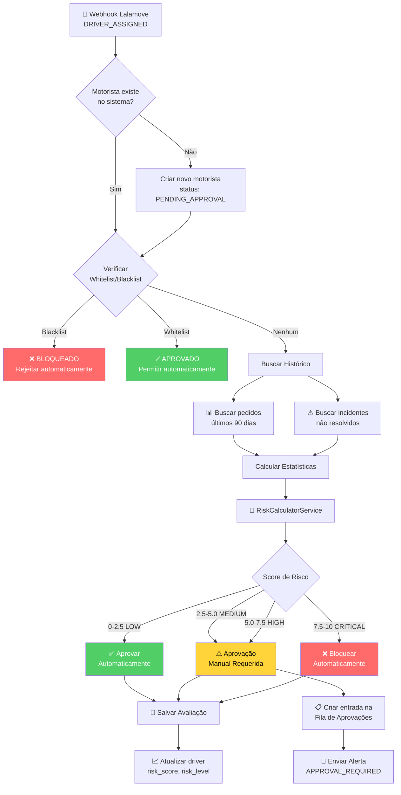
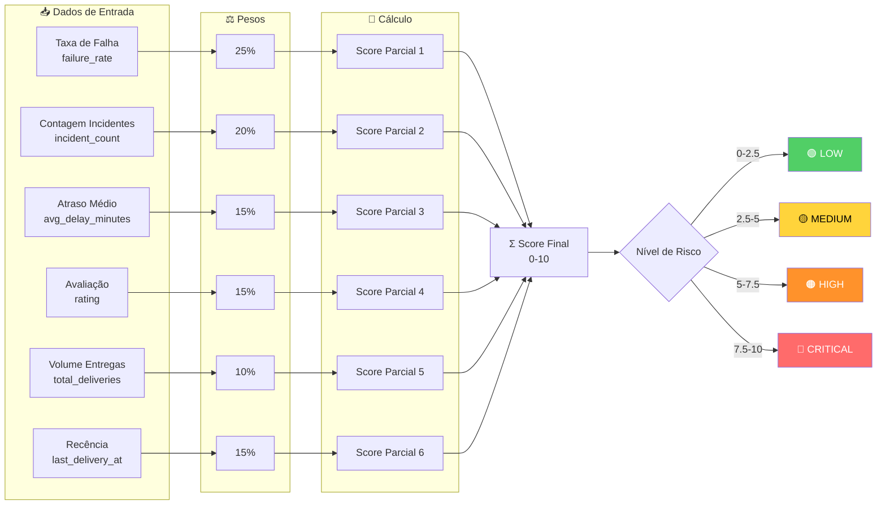
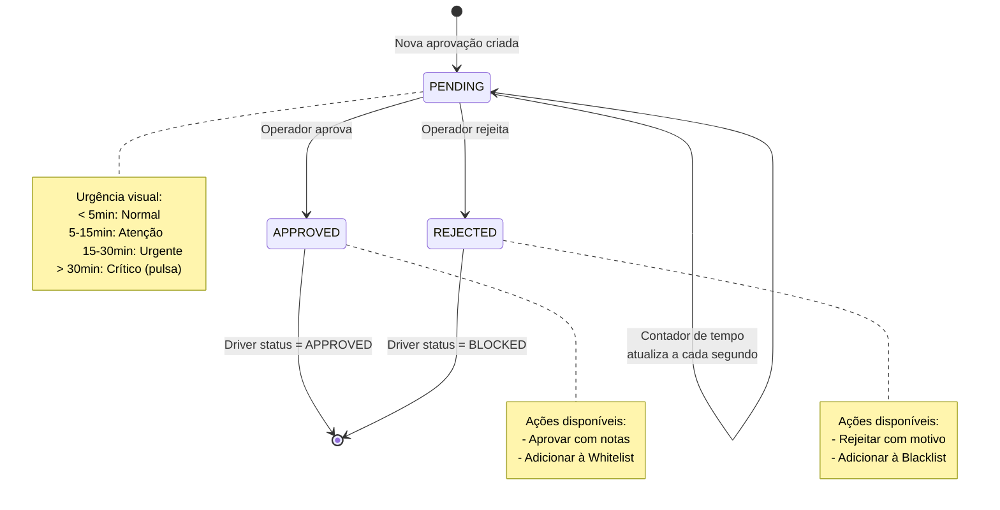
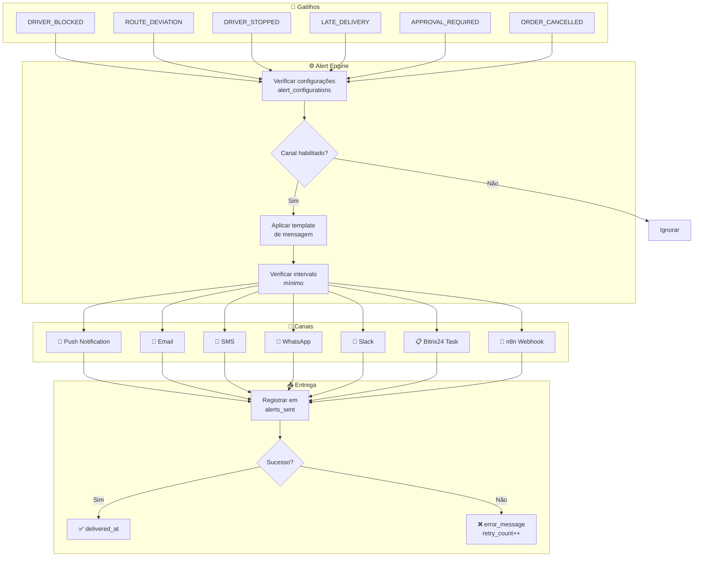
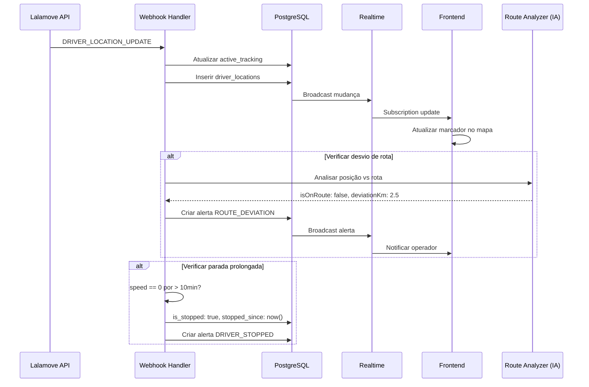
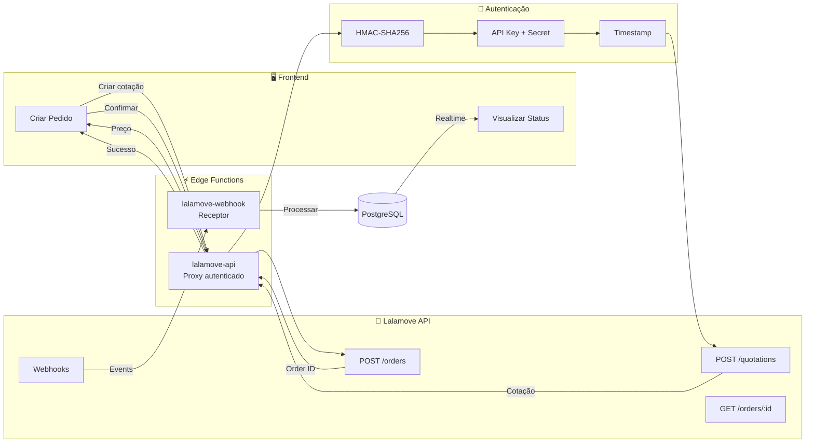
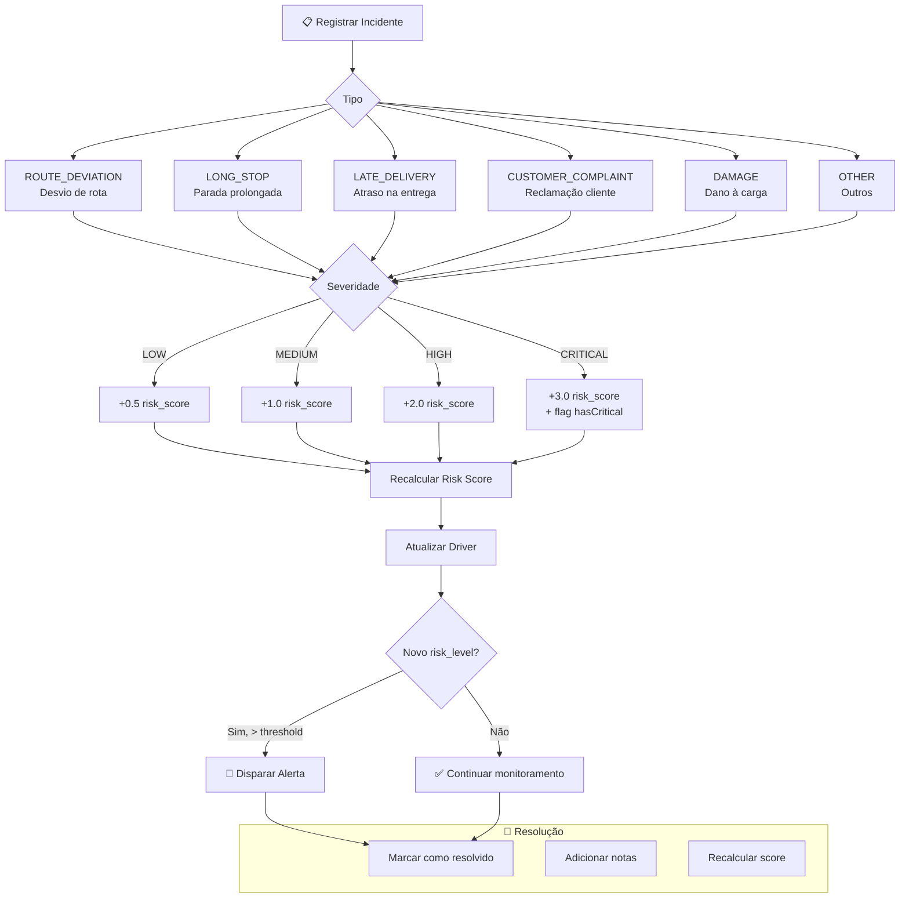

# 🚀 Lalamove Intelligence

> Sistema completo de gestão e rastreamento de entregas Lalamove com screening de motoristas, alertas em tempo real e integrações.


---

## 📋 Índice

- [Visão Geral](#-visão-geral)
- [Arquitetura](#-arquitetura)
- [Stack Tecnológico](#-stack-tecnológico)
- [Estrutura do Projeto](#-estrutura-do-projeto)
- [Instalação e Configuração](#-instalação-e-configuração)
- [Banco de Dados](#-banco-de-dados)
- [Edge Functions](#-edge-functions)
- [Componentes](#-componentes)
- [Hooks Customizados](#-hooks-customizados)
- [Serviços](#-serviços)
- [Páginas](#-páginas)
- [Funcionalidades Principais](#-funcionalidades-principais)
- [Integrações](#-integrações)
- [Variáveis de Ambiente](#-variáveis-de-ambiente)
- [Deploy](#-deploy)

---

## 🎯 Visão Geral

O **Lalamove Intelligence** é uma plataforma completa de gestão logística que integra com a API Lalamove para:

- **Monitoramento em tempo real** de entregas com mapa interativo
- **Avaliação automática de motoristas** com scoring de risco baseado em IA
- **Sistema de aprovações** com fila de aprovação manual para motoristas de risco
- **Alertas multicanal** (Push, Email, SMS, WhatsApp, Slack, Bitrix24)
- **Rastreamento GPS** com detecção de desvio de rota e paradas prolongadas
- **Dashboard analítico** com métricas de desempenho e SLA
- **Integração Bitrix24** para sincronização de deals/pedidos

---

## 📊 Diagramas de Fluxo

### Fluxo de Avaliação de Motorista



### Cálculo do Score de Risco



### Fluxo da Fila de Aprovações



### Sistema de Alertas Multicanal



### Rastreamento em Tempo Real



### Integração com Lalamove



### Fluxo de Incidentes




## 🏗 Arquitetura

```
┌─────────────────────────────────────────────────────────────────┐
│                        FRONTEND (React)                          │
│  ┌──────────┐ ┌──────────┐ ┌──────────┐ ┌──────────┐            │
│  │Dashboard │ │ LiveMap  │ │Approvals │ │ Settings │   ...      │
│  └────┬─────┘ └────┬─────┘ └────┬─────┘ └────┬─────┘            │
│       │            │            │            │                   │
│  ┌────┴────────────┴────────────┴────────────┴──────────────┐   │
│  │              React Query + Supabase Client                │   │
│  └────────────────────────────┬─────────────────────────────┘   │
└───────────────────────────────┼─────────────────────────────────┘
                                │
                    ┌───────────▼───────────┐
                    │   SUPABASE BACKEND    │
                    │  ┌─────────────────┐  │
                    │  │  Edge Functions │  │
                    │  │  ├─evaluate     │  │
                    │  │  ├─lalamove     │  │
                    │  │  ├─route-ai     │  │
                    │  │  └─notify       │  │
                    │  └────────┬────────┘  │
                    │           │           │
                    │  ┌────────▼────────┐  │
                    │  │   PostgreSQL    │  │
                    │  │   + Realtime    │  │
                    │  └────────┬────────┘  │
                    └───────────┼───────────┘
                                │
          ┌─────────────────────┼─────────────────────┐
          │                     │                     │
   ┌──────▼──────┐      ┌──────▼──────┐      ┌──────▼──────┐
   │  Lalamove   │      │  Bitrix24   │      │ Lovable AI  │
   │    API      │      │    API      │      │  (Gemini)   │
   └─────────────┘      └─────────────┘      └─────────────┘
```

---

## 🛠 Stack Tecnológico

### Frontend
| Tecnologia | Versão | Descrição |
|------------|--------|-----------|
| React | 18.3.1 | Biblioteca UI |
| TypeScript | 5.x | Tipagem estática |
| Vite | 5.x | Build tool |
| Tailwind CSS | 3.x | Framework CSS |
| shadcn/ui | - | Componentes UI |
| React Query | 5.83.0 | Gerenciamento de estado servidor |
| React Router | 6.30.1 | Roteamento |
| Mapbox GL | 3.17.0 | Mapas interativos |
| Recharts | 2.15.4 | Gráficos |
| React Hook Form | 7.61.1 | Formulários |
| Zod | 3.25.76 | Validação de schemas |
| Lucide React | 0.462.0 | Ícones |
| date-fns | 3.6.0 | Manipulação de datas |

### Backend (Supabase)
| Tecnologia | Descrição |
|------------|-----------|
| PostgreSQL | Banco de dados relacional |
| Edge Functions (Deno) | Serverless functions |
| Row Level Security | Políticas de segurança |
| Realtime | WebSocket subscriptions |
| Storage | Armazenamento de arquivos |

### Integrações
| Serviço | Descrição |
|---------|-----------|
| Lalamove API | API de entregas |
| Bitrix24 API | CRM sync |
| Lovable AI Gateway | IA (Gemini 2.5) |
| Mapbox | Mapas e geocoding |

---

## 📁 Estrutura do Projeto

```
lalamove-intelligence/
├── public/
│   ├── favicon.ico
│   ├── placeholder.svg
│   └── robots.txt
├── src/
│   ├── assets/                    # Assets estáticos
│   ├── components/
│   │   ├── approvals/
│   │   │   └── WaitingTimeCounter.tsx    # Contador tempo de espera
│   │   ├── dashboard/
│   │   │   ├── AIRouteChatbot.tsx        # Chatbot IA rotas
│   │   │   ├── AlertsPanel.tsx           # Painel de alertas
│   │   │   ├── ApprovalQueue.tsx         # Mini fila aprovações
│   │   │   ├── LiveMapPlaceholder.tsx    # Placeholder mapa
│   │   │   ├── OrdersTable.tsx           # Tabela de pedidos
│   │   │   ├── RiskScoreGauge.tsx        # Gauge de risco
│   │   │   └── StatsCard.tsx             # Cards estatísticos
│   │   ├── layout/
│   │   │   ├── AppLayout.tsx             # Layout principal
│   │   │   ├── Header.tsx                # Cabeçalho
│   │   │   └── Sidebar.tsx               # Menu lateral
│   │   ├── map/
│   │   │   ├── HeatMap.tsx               # Mapa de calor
│   │   │   └── LiveMap.tsx               # Mapa tempo real
│   │   ├── notifications/
│   │   │   └── RealtimeAlerts.tsx        # Alertas realtime
│   │   ├── orders/
│   │   │   └── OrderDetailModal.tsx      # Modal detalhes pedido
│   │   ├── ui/                           # 49 componentes shadcn/ui
│   │   │   ├── accordion.tsx
│   │   │   ├── alert.tsx
│   │   │   ├── badge.tsx
│   │   │   ├── button.tsx
│   │   │   ├── card.tsx
│   │   │   ├── dialog.tsx
│   │   │   ├── dropdown-menu.tsx
│   │   │   ├── form.tsx
│   │   │   ├── input.tsx
│   │   │   ├── select.tsx
│   │   │   ├── sheet.tsx
│   │   │   ├── sidebar.tsx
│   │   │   ├── skeleton.tsx
│   │   │   ├── switch.tsx
│   │   │   ├── table.tsx
│   │   │   ├── tabs.tsx
│   │   │   ├── toast.tsx
│   │   │   └── ... (mais 32 componentes)
│   │   └── NavLink.tsx
│   ├── hooks/
│   │   ├── useActiveAlerts.ts            # Alertas ativos
│   │   ├── useAlertConfigurations.ts     # Config alertas
│   │   ├── useApprovalRealtime.ts        # Realtime aprovações
│   │   ├── useAuth.tsx                   # Autenticação
│   │   ├── useBitrix24.ts                # Integração Bitrix
│   │   ├── useDashboardStats.ts          # Stats dashboard
│   │   ├── useDeliveryHeatmapData.ts     # Dados heatmap
│   │   ├── useDeliveryMetrics.ts         # Métricas entrega
│   │   ├── useDriverEvaluations.ts       # Avaliações motoristas
│   │   ├── useDrivers.ts                 # CRUD motoristas
│   │   ├── useEvaluateDriver.ts          # Avaliar motorista
│   │   ├── useIncidents.ts               # Incidentes
│   │   ├── useMetrics.ts                 # Métricas gerais
│   │   ├── useMobile.tsx                 # Detecção mobile
│   │   ├── useNotificationHistory.ts     # Histórico notificações
│   │   ├── usePendingApprovals.ts        # Aprovações pendentes
│   │   ├── usePushNotifications.ts       # Push notifications
│   │   ├── useRecentOrders.ts            # Pedidos recentes
│   │   ├── useRiskRules.ts               # Regras de risco
│   │   ├── useSLAMetrics.ts              # Métricas SLA
│   │   ├── useSoundSettings.ts           # Config sons
│   │   ├── useTestNotification.ts        # Teste notificações
│   │   ├── useToast.ts                   # Toasts
│   │   ├── useTrackingHistory.ts         # Histórico tracking
│   │   └── useWebhookEvents.ts           # Eventos webhook
│   ├── integrations/
│   │   └── supabase/
│   │       ├── client.ts                 # Cliente Supabase
│   │       └── types.ts                  # Tipos auto-gerados
│   ├── lib/
│   │   ├── mock-data.ts                  # Dados de exemplo
│   │   └── utils.ts                      # Utilitários (cn)
│   ├── pages/
│   │   ├── AlertConfigurationsPage.tsx   # Config alertas
│   │   ├── AlertsPage.tsx                # Lista alertas
│   │   ├── ApprovalsPage.tsx             # Fila aprovações
│   │   ├── AuthPage.tsx                  # Login/Registro
│   │   ├── Bitrix24Page.tsx              # Integração Bitrix
│   │   ├── Dashboard.tsx                 # Dashboard principal
│   │   ├── DeliveryMetricsPage.tsx       # Métricas entrega
│   │   ├── DriversPage.tsx               # Gestão motoristas
│   │   ├── EvaluationsPage.tsx           # Avaliações
│   │   ├── HeatmapPage.tsx               # Mapa de calor
│   │   ├── IncidentsPage.tsx             # Incidentes
│   │   ├── LiveMapPage.tsx               # Mapa tempo real
│   │   ├── MetricsPage.tsx               # Métricas
│   │   ├── NotFound.tsx                  # 404
│   │   ├── NotificationHistoryPage.tsx   # Histórico notif.
│   │   ├── OrdersPage.tsx                # Lista pedidos
│   │   ├── ReportsPage.tsx               # Relatórios
│   │   ├── RiskRulesPage.tsx             # Regras risco
│   │   ├── SettingsPage.tsx              # Configurações
│   │   ├── SLADashboardPage.tsx          # Dashboard SLA
│   │   └── WebhooksPage.tsx              # Eventos webhook
│   ├── services/
│   │   ├── ApprovalService.ts            # Serviço aprovações
│   │   ├── DriverEvaluatorService.ts     # Avaliador motoristas
│   │   ├── IncidentService.ts            # Serviço incidentes
│   │   ├── RiskCalculatorService.ts      # Calculadora risco
│   │   └── index.ts                      # Barrel exports
│   ├── types/
│   │   ├── driver.ts                     # Tipos motorista
│   │   └── index.ts                      # Tipos globais
│   ├── utils/
│   │   └── alertSounds.ts                # Web Audio API sons
│   ├── App.css
│   ├── App.tsx                           # App principal
│   ├── index.css                         # Estilos globais
│   ├── main.tsx                          # Entry point
│   └── vite-env.d.ts
├── supabase/
│   ├── functions/
│   │   ├── bitrix24-process-queue/       # Processa fila Bitrix
│   │   ├── bitrix24-sync/                # Sync Bitrix24
│   │   ├── check-driver-alerts/          # Verifica alertas
│   │   ├── evaluate-driver/              # Avalia motorista
│   │   ├── get-mapbox-token/             # Token Mapbox
│   │   ├── lalamove-api/                 # Proxy Lalamove
│   │   ├── lalamove-webhook/             # Webhook Lalamove
│   │   ├── route-analyzer/               # Análise IA rotas
│   │   ├── send-notification/            # Notificações multi
│   │   ├── simulate-driver-movement/     # Simulador GPS
│   │   └── test-notification/            # Teste notificações
│   ├── migrations/                       # 7 arquivos SQL
│   └── config.toml                       # Config Supabase
├── .env                                  # Variáveis ambiente
├── .gitignore
├── components.json                       # Config shadcn/ui
├── eslint.config.js
├── index.html
├── package.json
├── postcss.config.js
├── tailwind.config.ts
├── tsconfig.json
├── tsconfig.app.json
├── tsconfig.node.json
└── vite.config.ts
```

---

## ⚙️ Instalação e Configuração

### Pré-requisitos
- Node.js 18+
- npm ou bun
- Conta Lovable (para Supabase integrado)

### Instalação Local

```bash
# Clone o repositório
git clone <YOUR_GIT_URL>

# Navegue até o diretório
cd lalamove-intelligence

# Instale as dependências
npm install

# Inicie o servidor de desenvolvimento
npm run dev
```

### Scripts Disponíveis

```json
{
  "dev": "vite",
  "build": "vite build",
  "preview": "vite preview",
  "lint": "eslint ."
}
```

---

## 🗄 Banco de Dados

### Tabelas Principais

#### `drivers` - Motoristas
| Coluna | Tipo | Descrição |
|--------|------|-----------|
| id | UUID | ID único |
| lalamove_id | TEXT | ID Lalamove |
| name | TEXT | Nome |
| phone | TEXT | Telefone |
| photo_url | TEXT | URL foto |
| vehicle_type | ENUM | Tipo veículo |
| vehicle_plate | TEXT | Placa |
| status | ENUM | Status |
| risk_score | NUMERIC | Score de risco (0-10) |
| risk_level | TEXT | Nível (LOW/MEDIUM/HIGH/CRITICAL) |
| total_deliveries | INT | Total entregas |
| completed_deliveries | INT | Entregas concluídas |
| failed_deliveries | INT | Entregas falhas |
| cancelled_deliveries | INT | Entregas canceladas |
| success_rate | NUMERIC | Taxa sucesso % |
| failure_rate | NUMERIC | Taxa falha % |
| rating | NUMERIC | Avaliação (0-5) |
| whitelisted | BOOLEAN | Na whitelist |
| blacklisted | BOOLEAN | Na blacklist |
| blacklist_reason | TEXT | Motivo blacklist |
| last_active_at | TIMESTAMP | Última atividade |
| last_delivery_at | TIMESTAMP | Última entrega |
| first_seen_at | TIMESTAMP | Primeiro registro |
| last_evaluated_at | TIMESTAMP | Última avaliação |
| created_at | TIMESTAMP | Criado em |
| updated_at | TIMESTAMP | Atualizado em |

#### `lalamove_orders` - Pedidos
| Coluna | Tipo | Descrição |
|--------|------|-----------|
| id | UUID | ID único |
| lalamove_id | TEXT | ID Lalamove |
| internal_order_id | TEXT | ID interno |
| status | ENUM | Status pedido |
| pickup_address | TEXT | Endereço coleta |
| pickup_latitude | NUMERIC | Lat coleta |
| pickup_longitude | NUMERIC | Lng coleta |
| delivery_address | TEXT | Endereço entrega |
| delivery_latitude | NUMERIC | Lat entrega |
| delivery_longitude | NUMERIC | Lng entrega |
| customer_name | TEXT | Nome cliente |
| customer_phone | TEXT | Telefone cliente |
| driver_id | UUID | FK motorista |
| vehicle_type | ENUM | Tipo veículo |
| total_cost | NUMERIC | Custo total |
| currency | TEXT | Moeda (BRL) |
| scheduled_at | TIMESTAMP | Agendado para |
| estimated_delivery | TIMESTAMP | Previsão entrega |
| actual_delivery | TIMESTAMP | Entrega real |
| delay_minutes | INT | Atraso (min) |
| duration_minutes | INT | Duração (min) |
| distance_meters | INT | Distância (m) |
| outcome | ENUM | Resultado |
| is_urgent | BOOLEAN | Urgente |
| tags | TEXT[] | Tags |
| bitrix24_deal_id | INT | Deal Bitrix |
| created_at | TIMESTAMP | Criado em |
| updated_at | TIMESTAMP | Atualizado em |

#### `driver_approval_queue` - Fila de Aprovações
| Coluna | Tipo | Descrição |
|--------|------|-----------|
| id | UUID | ID único |
| driver_id | UUID | FK motorista |
| driver_name | TEXT | Nome motorista |
| order_id | UUID | FK pedido |
| status | ENUM | PENDING/APPROVED/REJECTED |
| risk_score | NUMERIC | Score risco |
| risk_factors | TEXT[] | Fatores de risco |
| priority | INT | Prioridade numérica |
| approval_priority | ENUM | LOW/MEDIUM/HIGH/URGENT/CRITICAL |
| notes | TEXT | Notas |
| decision_notes | TEXT | Notas da decisão |
| requested_at | TIMESTAMP | Solicitado em |
| reviewed_at | TIMESTAMP | Revisado em |
| reviewed_by | UUID | Revisado por |

#### `driver_evaluations` - Avaliações
| Coluna | Tipo | Descrição |
|--------|------|-----------|
| id | UUID | ID único |
| driver_id | UUID | FK motorista |
| order_id | UUID | FK pedido |
| risk_score | NUMERIC | Score calculado |
| risk_level | TEXT | Nível risco |
| risk_factors | JSONB | Fatores detalhados |
| risk_reasons | TEXT[] | Razões |
| approved | BOOLEAN | Aprovado auto |
| requires_manual | BOOLEAN | Requer manual |
| auto_blocked | BOOLEAN | Bloqueado auto |
| total_deliveries | INT | Total entregas |
| completed_deliveries | INT | Concluídas |
| failure_rate | NUMERIC | Taxa falha |
| incident_count | INT | Qtd incidentes |
| recommendation | TEXT | Recomendação |
| action_required | TEXT | Ação necessária |
| triggered_by | TEXT | Gatilho |
| evaluated_at | TIMESTAMP | Avaliado em |

#### `driver_incidents` - Incidentes
| Coluna | Tipo | Descrição |
|--------|------|-----------|
| id | UUID | ID único |
| driver_id | UUID | FK motorista |
| order_id | UUID | FK pedido |
| type | ENUM | Tipo incidente |
| severity | ENUM | LOW/MEDIUM/HIGH/CRITICAL |
| description | TEXT | Descrição |
| resolved | BOOLEAN | Resolvido |
| resolved_at | TIMESTAMP | Resolvido em |
| resolution_notes | TEXT | Notas resolução |
| reported_by | TEXT | Reportado por |
| evidence_urls | TEXT[] | URLs evidências |
| metadata | JSONB | Metadados |
| created_at | TIMESTAMP | Criado em |

#### `active_tracking` - Rastreamento Ativo
| Coluna | Tipo | Descrição |
|--------|------|-----------|
| id | UUID | ID único |
| order_id | UUID | FK pedido |
| driver_id | UUID | FK motorista |
| current_latitude | NUMERIC | Lat atual |
| current_longitude | NUMERIC | Lng atual |
| heading | NUMERIC | Direção |
| speed | NUMERIC | Velocidade |
| is_on_route | BOOLEAN | Na rota |
| is_stopped | BOOLEAN | Parado |
| stopped_since | TIMESTAMP | Parado desde |
| expected_route | JSONB | Rota esperada |
| origin_lat/lng | NUMERIC | Origem |
| destination_lat/lng | NUMERIC | Destino |
| eta_minutes | INT | ETA (min) |
| tracking_status | TEXT | Status tracking |
| alerts_sent | JSONB | Alertas enviados |
| tracking_started_at | TIMESTAMP | Início tracking |
| tracking_ended_at | TIMESTAMP | Fim tracking |
| last_updated | TIMESTAMP | Atualizado em |

#### `alerts` - Alertas
| Coluna | Tipo | Descrição |
|--------|------|-----------|
| id | UUID | ID único |
| type | ENUM | Tipo alerta |
| severity | ENUM | INFO/WARNING/CRITICAL |
| title | TEXT | Título |
| message | TEXT | Mensagem |
| order_id | UUID | FK pedido |
| driver_id | UUID | FK motorista |
| is_read | BOOLEAN | Lido |
| is_dismissed | BOOLEAN | Dispensado |
| metadata | JSONB | Metadados |
| created_at | TIMESTAMP | Criado em |

#### `alert_configurations` - Configurações de Alerta
| Coluna | Tipo | Descrição |
|--------|------|-----------|
| id | UUID | ID único |
| name | TEXT | Nome |
| alert_type | ENUM | Tipo |
| channel | TEXT | Canal |
| is_enabled | BOOLEAN | Ativo |
| notify_email | BOOLEAN | Email |
| notify_sms | BOOLEAN | SMS |
| notify_whatsapp | BOOLEAN | WhatsApp |
| notify_slack | BOOLEAN | Slack |
| notify_bitrix24_task | BOOLEAN | Bitrix24 |
| notify_n8n_webhook | BOOLEAN | n8n |
| email_addresses | TEXT[] | Emails |
| sms_numbers | TEXT[] | Números SMS |
| whatsapp_numbers | TEXT[] | Números WhatsApp |
| slack_channels | TEXT[] | Canais Slack |
| bitrix24_user_ids | INT[] | IDs Bitrix24 |
| n8n_webhook_url | TEXT | URL n8n |
| conditions | JSONB | Condições |
| message_template | TEXT | Template |
| min_interval_seconds | INT | Intervalo mínimo |
| created_at | TIMESTAMP | Criado em |
| updated_at | TIMESTAMP | Atualizado em |

### Outras Tabelas

| Tabela | Descrição |
|--------|-----------|
| `alerts_sent` | Log de alertas enviados |
| `risk_rules` | Regras customizadas de risco |
| `tracking_events` | Eventos de rastreamento |
| `driver_locations` | Histórico de localizações |
| `lalamove_status_history` | Histórico status pedidos |
| `lalamove_stops` | Paradas do pedido |
| `webhook_events` | Eventos webhook recebidos |
| `bitrix24_sync` | Sincronização Bitrix24 |
| `bitrix24_tokens` | Tokens OAuth Bitrix24 |
| `bitrix24_activities` | Atividades Bitrix24 |
| `bitrix24_stage_mappings` | Mapeamento estágios |

### Enums

```sql
-- Status do pedido
CREATE TYPE order_status AS ENUM (
  'PENDING', 'MATCHED', 'ON_GOING', 'PICKED_UP',
  'COMPLETED', 'CANCELLED', 'REJECTED', 'EXPIRED'
);

-- Status do motorista
CREATE TYPE driver_status AS ENUM (
  'APPROVED', 'PENDING_APPROVAL', 'BLOCKED',
  'WHITELIST', 'BLACKLIST'
);

-- Tipo de veículo
CREATE TYPE vehicle_type AS ENUM (
  'MOTORCYCLE', 'CAR', 'VAN', 'TRUCK'
);

-- Tipo de incidente
CREATE TYPE incident_type AS ENUM (
  'ROUTE_DEVIATION', 'LONG_STOP', 'LATE_DELIVERY',
  'CUSTOMER_COMPLAINT', 'DAMAGE', 'OTHER'
);

-- Severidade do incidente
CREATE TYPE incident_severity AS ENUM (
  'LOW', 'MEDIUM', 'HIGH', 'CRITICAL'
);

-- Resultado da entrega
CREATE TYPE delivery_outcome AS ENUM (
  'SUCCESS', 'FAILED', 'DAMAGED', 'STOLEN',
  'LATE', 'WRONG_ADDRESS', 'CUSTOMER_UNAVAILABLE'
);

-- Status da aprovação
CREATE TYPE approval_status AS ENUM (
  'PENDING', 'APPROVED', 'REJECTED'
);

-- Prioridade da aprovação
CREATE TYPE approval_priority AS ENUM (
  'LOW', 'MEDIUM', 'HIGH', 'URGENT', 'CRITICAL'
);

-- Tipo de alerta
CREATE TYPE alert_type AS ENUM (
  'DRIVER_BLOCKED', 'ROUTE_DEVIATION', 'DRIVER_STOPPED',
  'LATE_DELIVERY', 'APPROVAL_REQUIRED', 'ORDER_CANCELLED'
);

-- Severidade do alerta
CREATE TYPE alert_severity AS ENUM (
  'INFO', 'WARNING', 'CRITICAL'
);
```

---

## ⚡ Edge Functions

### `evaluate-driver`
Avalia o risco de um motorista baseado em histórico, incidentes e métricas.

```typescript
// Input
{
  driverId: string;
  orderId: string;
  driverName?: string;
  triggeredBy?: string;
}

// Output
{
  success: boolean;
  evaluation: {
    driverId: string;
    approved: boolean;
    requiresManual: boolean;
    autoBlocked: boolean;
    riskScore: number;
    riskLevel: 'LOW' | 'MEDIUM' | 'HIGH' | 'CRITICAL';
    riskFactors: Array<{
      factor: string;
      weight: number;
      score: number;
    }>;
    reasons: string[];
    recommendation: string;
    actionRequired?: string;
  };
}
```

### `lalamove-webhook`
Recebe webhooks da Lalamove e processa atualizações de status.

```typescript
// Eventos suportados
- ORDER_STATUS_CHANGED
- DRIVER_ASSIGNED
- DRIVER_LOCATION_UPDATE
- POD_UPLOADED
```

### `lalamove-api`
Proxy para a API Lalamove com autenticação HMAC.

```typescript
// Endpoints
POST /quotations     - Criar cotação
POST /orders         - Criar pedido
GET  /orders/:id     - Buscar pedido
PUT  /orders/:id     - Atualizar pedido
```

### `route-analyzer`
Análise de rotas com IA (Lovable AI + Gemini 2.5 Flash).

```typescript
// Input
{
  orderId: string;
  origin: { lat: number; lng: number };
  destination: { lat: number; lng: number };
  currentPosition: { lat: number; lng: number };
}

// Output
{
  analysis: string;
  isOnRoute: boolean;
  deviationKm: number;
  estimatedDelay: number;
  recommendations: string[];
}
```

### `send-notification`
Sistema multicanal de notificações.

```typescript
// Canais suportados
- push      // Push Notifications (Service Worker)
- email     // Email (via API)
- sms       // SMS (via API)
- whatsapp  // WhatsApp (via API)
- slack     // Slack webhooks
- bitrix24  // Bitrix24 tasks
- n8n       // n8n webhooks
```

### `check-driver-alerts`
Verifica condições para disparo de alertas automáticos.

### `simulate-driver-movement`
Simula movimento GPS de motoristas para testes.

### `bitrix24-sync`
Sincroniza pedidos com deals do Bitrix24.

### `bitrix24-process-queue`
Processa fila de sincronização Bitrix24.

### `get-mapbox-token`
Retorna token Mapbox de forma segura.

### `test-notification`
Endpoint para teste de notificações push.

---

## 🧩 Componentes

### Dashboard
| Componente | Descrição |
|------------|-----------|
| `StatsCard` | Card com estatística e ícone |
| `RiskScoreGauge` | Gauge visual de risco (0-10) |
| `OrdersTable` | Tabela de pedidos recentes |
| `ApprovalQueue` | Mini fila de aprovações |
| `AlertsPanel` | Painel de alertas ativos |
| `LiveMapPlaceholder` | Placeholder do mapa |
| `AIRouteChatbot` | Chatbot IA para análise de rotas |

### Approvals
| Componente | Descrição |
|------------|-----------|
| `WaitingTimeCounter` | Contador tempo de espera com urgência visual |

### Map
| Componente | Descrição |
|------------|-----------|
| `LiveMap` | Mapa Mapbox com motoristas em tempo real |
| `HeatMap` | Mapa de calor de entregas |

### Layout
| Componente | Descrição |
|------------|-----------|
| `AppLayout` | Layout principal com sidebar |
| `Header` | Cabeçalho com busca e perfil |
| `Sidebar` | Menu lateral de navegação |

### Notifications
| Componente | Descrição |
|------------|-----------|
| `RealtimeAlerts` | Componente de alertas realtime |

### Orders
| Componente | Descrição |
|------------|-----------|
| `OrderDetailModal` | Modal detalhes do pedido |

---

## 🪝 Hooks Customizados

### Dados e Estado

| Hook | Descrição | Exports |
|------|-----------|---------|
| `useAuth` | Autenticação Supabase | `user`, `session`, `signIn`, `signUp`, `signOut`, `loading` |
| `useDashboardStats` | Estatísticas dashboard | `stats`, `isLoading`, `refetch` |
| `useRecentOrders` | Pedidos recentes | `orders`, `isLoading` |
| `usePendingApprovals` | Aprovações pendentes | `approvals`, `isLoading`, `approve`, `reject` |
| `useActiveAlerts` | Alertas ativos | `alerts`, `isLoading`, `dismiss` |
| `useDrivers` | CRUD motoristas | `drivers`, `create`, `update`, `delete` |
| `useDriverEvaluations` | Avaliações | `evaluations`, `isLoading` |
| `useIncidents` | Incidentes | `incidents`, `create`, `resolve` |
| `useEvaluateDriver` | Avaliar motorista | `evaluate`, `isEvaluating`, `result` |

### Configuração

| Hook | Descrição | Exports |
|------|-----------|---------|
| `useAlertConfigurations` | Config alertas | `configs`, `save`, `delete` |
| `useRiskRules` | Regras de risco | `rules`, `create`, `update`, `delete` |
| `useSoundSettings` | Sons de alerta | `settings`, `updateSettings`, `playSound`, `testSound` |

### Métricas

| Hook | Descrição | Exports |
|------|-----------|---------|
| `useMetrics` | Métricas gerais | `metrics`, `isLoading` |
| `useDeliveryMetrics` | Métricas entrega | `metrics`, `filters`, `setFilters` |
| `useSLAMetrics` | Métricas SLA | `sla`, `isLoading` |
| `useDeliveryHeatmapData` | Dados heatmap | `data`, `isLoading` |

### Realtime e Notificações

| Hook | Descrição | Exports |
|------|-----------|---------|
| `useApprovalRealtime` | Realtime aprovações | `approvals`, `newCount` |
| `usePushNotifications` | Push notifications | `permission`, `requestPermission`, `sendNotification` |
| `useNotificationHistory` | Histórico notif. | `notifications`, `isLoading` |
| `useTestNotification` | Teste notificações | `testPush`, `isTesting` |

### Integrações

| Hook | Descrição | Exports |
|------|-----------|---------|
| `useBitrix24` | Integração Bitrix24 | `sync`, `status`, `mappings` |
| `useWebhookEvents` | Eventos webhook | `events`, `isLoading` |
| `useTrackingHistory` | Histórico tracking | `history`, `isLoading` |

### Utilitários

| Hook | Descrição | Exports |
|------|-----------|---------|
| `useMobile` | Detecção mobile | `isMobile` |
| `useToast` | Sistema de toasts | `toast`, `dismiss` |

---

## 🔧 Serviços

### RiskCalculatorService
Calcula score de risco baseado em múltiplos fatores.

```typescript
class RiskCalculatorService {
  // Pesos dos fatores
  static WEIGHTS = {
    failureRate: 0.25,      // 25%
    incidentCount: 0.20,    // 20%
    avgDelay: 0.15,         // 15%
    rating: 0.15,           // 15%
    deliveryVolume: 0.10,   // 10%
    recency: 0.15           // 15%
  };

  calculate(stats: DriverStats, incidentCount: number, hasCritical: boolean): RiskAnalysis;
  
  // Níveis de risco
  // 0.0 - 2.5: LOW
  // 2.5 - 5.0: MEDIUM
  // 5.0 - 7.5: HIGH
  // 7.5 - 10.0: CRITICAL
}
```

### DriverEvaluatorService
Orquestra a avaliação completa de motoristas.

```typescript
class DriverEvaluatorService {
  evaluateDriver(driverId: string, orderId: string): Promise<EvaluationResult>;
  
  // Fluxo:
  // 1. Buscar dados do motorista
  // 2. Verificar whitelist/blacklist
  // 3. Buscar histórico de pedidos
  // 4. Buscar incidentes
  // 5. Calcular estatísticas
  // 6. Calcular risco (RiskCalculatorService)
  // 7. Tomar decisão automática
  // 8. Salvar avaliação
  // 9. Criar aprovação se necessário
}
```

### ApprovalService
Gerencia fila de aprovações.

```typescript
class ApprovalService {
  createApprovalRequest(request: ApprovalRequest): Promise<string>;
  getPendingApprovals(limit?: number): Promise<ApprovalQueue[]>;
  approveDriver(id: string, approvedBy: string, notes: string): Promise<void>;
  rejectDriver(id: string, rejectedBy: string, reason: string): Promise<void>;
  addToWhitelist(driverId: string, reason: string): Promise<void>;
  addToBlacklist(driverId: string, reason: string): Promise<void>;
}
```

### IncidentService
Gerencia incidentes de motoristas.

```typescript
class IncidentService {
  createIncident(input: CreateIncidentInput): Promise<Incident>;
  resolveIncident(input: ResolveIncidentInput): Promise<Incident>;
  getDriverIncidents(driverId: string, unresolvedOnly?: boolean): Promise<Incident[]>;
  getIncidentStats(driverId: string): Promise<IncidentStats>;
}
```

---

## 📄 Páginas

| Rota | Página | Descrição |
|------|--------|-----------|
| `/` | Dashboard | Dashboard principal com stats, mapa e alertas |
| `/auth` | AuthPage | Login e registro |
| `/orders` | OrdersPage | Lista e gestão de pedidos |
| `/live-map` | LiveMapPage | Mapa tempo real com motoristas |
| `/heatmap` | HeatmapPage | Mapa de calor de entregas |
| `/approvals` | ApprovalsPage | Fila de aprovações pendentes |
| `/drivers` | DriversPage | Gestão de motoristas |
| `/evaluations` | EvaluationsPage | Histórico de avaliações |
| `/incidents` | IncidentsPage | Gestão de incidentes |
| `/alerts` | AlertsPage | Lista de alertas |
| `/alert-configurations` | AlertConfigurationsPage | Configurar alertas |
| `/risk-rules` | RiskRulesPage | Regras customizadas de risco |
| `/metrics` | MetricsPage | Métricas gerais |
| `/delivery-metrics` | DeliveryMetricsPage | Métricas de entrega |
| `/sla-dashboard` | SLADashboardPage | Dashboard SLA |
| `/reports` | ReportsPage | Relatórios |
| `/webhooks` | WebhooksPage | Eventos webhook |
| `/notifications` | NotificationHistoryPage | Histórico notificações |
| `/bitrix24` | Bitrix24Page | Integração Bitrix24 |
| `/settings` | SettingsPage | Configurações (sons, push, etc.) |

---

## 🎯 Funcionalidades Principais

### 1. Avaliação Automática de Motoristas
- Análise de histórico de entregas
- Contagem e severidade de incidentes
- Cálculo de taxa de sucesso/falha
- Score de risco ponderado (0-10)
- Decisão automática (aprovar/bloquear/manual)

### 2. Fila de Aprovações
- Aprovações pendentes com contador de tempo
- Priorização por score de risco
- Urgência visual progressiva
- Ações de aprovar/rejeitar com notas
- Whitelist/Blacklist rápido

### 3. Sistema de Alertas Multicanal
- Push Notifications nativas
- Email
- SMS
- WhatsApp
- Slack
- Bitrix24 Tasks
- n8n Webhooks
- Sons configuráveis por tipo

### 4. Rastreamento em Tempo Real
- Mapa Mapbox interativo
- Posição atual de motoristas
- Detecção de desvio de rota
- Detecção de paradas prolongadas
- ETA dinâmico

### 5. Análise de Rotas com IA
- Integração Lovable AI (Gemini 2.5)
- Análise de desvios
- Previsão de atrasos
- Recomendações automáticas

### 6. Integração Lalamove
- Recebimento de webhooks
- Atualização de status em tempo real
- Proxy autenticado para API
- Cotações e criação de pedidos

### 7. Integração Bitrix24
- Sincronização de deals
- Mapeamento de estágios
- Criação de atividades
- OAuth2 flow

### 8. Dashboard Analítico
- KPIs em tempo real
- Gráficos de performance
- Métricas de SLA
- Mapa de calor de entregas

### 9. Gestão de Incidentes
- Registro de incidentes por tipo
- Severidade (LOW/MEDIUM/HIGH/CRITICAL)
- Workflow de resolução
- Impacto no score de risco

### 10. Sons de Alerta Configuráveis
- Web Audio API
- 4 tipos de som por severidade
- Volume ajustável
- Teste de sons
- Persistência em localStorage

### 11. Push Notifications
- Service Worker nativo
- Permission request
- Notificações ricas com ações
- Deep links para aprovações

---

## 🔗 Integrações

### Lalamove API
```typescript
// Autenticação HMAC-SHA256
const signature = hmac(
  `${timestamp}\r\n${method}\r\n${path}\r\n\r\n${body}`,
  LALAMOVE_API_SECRET
);

// Headers
{
  'Authorization': `hmac ${LALAMOVE_API_KEY}:${timestamp}:${signature}`,
  'X-LLM-Market': 'BR',
  'Content-Type': 'application/json'
}
```

### Bitrix24 API
```typescript
// OAuth2 Flow
// 1. Autorização: /oauth/authorize
// 2. Token: /oauth/token
// 3. Refresh: /oauth/token (refresh_token)

// Endpoints
// crm.deal.list - Listar deals
// crm.deal.update - Atualizar deal
// crm.activity.add - Criar atividade
```

### Lovable AI Gateway
```typescript
// Endpoint
POST https://ai.gateway.lovable.dev/v1/chat/completions

// Headers
{
  'Authorization': `Bearer ${LOVABLE_API_KEY}`,
  'Content-Type': 'application/json'
}

// Body
{
  model: 'google/gemini-2.5-flash',
  messages: [...],
  stream: true
}
```

### Mapbox GL JS
```typescript
// Inicialização
mapboxgl.accessToken = MAPBOX_ACCESS_TOKEN;

const map = new mapboxgl.Map({
  container: 'map',
  style: 'mapbox://styles/mapbox/streets-v12',
  center: [-46.6388, -23.5489], // São Paulo
  zoom: 12
});
```

---

## 🔐 Variáveis de Ambiente

### Automáticas (Lovable Cloud)
```env
VITE_SUPABASE_URL=https://xxx.supabase.co
VITE_SUPABASE_PUBLISHABLE_KEY=eyJ...
VITE_SUPABASE_PROJECT_ID=xxx
```

### Secrets (Supabase)
```env
SUPABASE_URL=https://xxx.supabase.co
SUPABASE_ANON_KEY=eyJ...
SUPABASE_SERVICE_ROLE_KEY=eyJ...
SUPABASE_DB_URL=postgresql://...
SUPABASE_PUBLISHABLE_KEY=eyJ...
LALAMOVE_API_KEY=xxx
LALAMOVE_API_SECRET=xxx
LALAMOVE_BASE_URL=https://rest.lalamove.com
MAPBOX_ACCESS_TOKEN=pk.xxx
LOVABLE_API_KEY=xxx
```

---

## 🚀 Deploy

### Lovable Cloud (Automático)
1. Faça push para o repositório GitHub
2. Lovable sincroniza automaticamente
3. Edge Functions são deployed automaticamente
4. Frontend é built e publicado

### Publicar
1. Clique em **Publish** no editor Lovable
2. Configure domínio customizado se desejado
3. App disponível em `*.lovable.app`

---

## 📚 Recursos Adicionais

- [Documentação Lovable](https://docs.lovable.dev/)
- [Documentação Supabase](https://supabase.com/docs)
- [Documentação Lalamove API](https://developers.lalamove.com/)
- [Documentação Mapbox GL JS](https://docs.mapbox.com/mapbox-gl-js/)
- [Documentação shadcn/ui](https://ui.shadcn.com/)

---

## 🤝 Contribuição

Este projeto foi desenvolvido em parceria:
- **Lovable** - Plataforma de desenvolvimento
- **Claude (Anthropic)** - Assistente IA

Arquivos desenvolvidos com Claude:
- `src/types/driver.ts` - Tipos estendidos de motorista
- Diversas Edge Functions
- Lógica de serviços

---

## 📝 Licença

Projeto privado. Todos os direitos reservados.

---

## 📞 Suporte

Para suporte, entre em contato através da plataforma Lovable ou abra uma issue no repositório.
