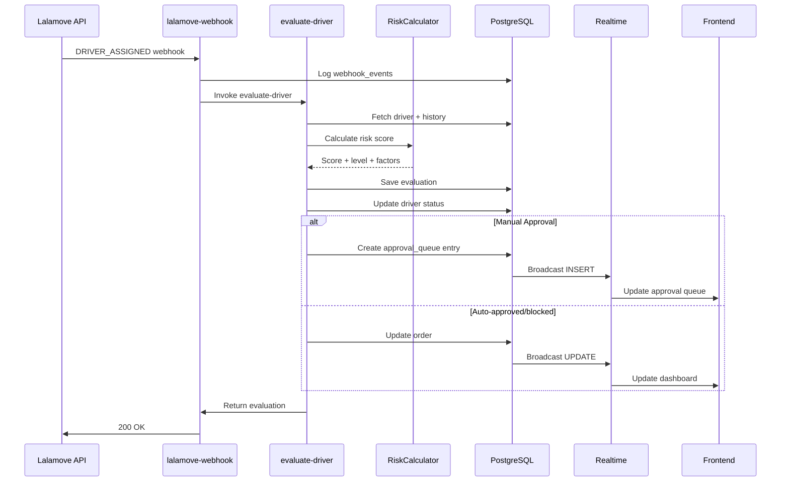

# 🏗️ Arquitetura - Lalamove Guardian

**Versão:** 1.5.0  
**Última atualização:** 25 de dezembro de 2025

---

## 📋 Índice

- [Visão Geral](#visão-geral)
- [Diagrama de Arquitetura](#diagrama-de-arquitetura)
- [Camadas](#camadas)
- [Integrações Externas](#integrações-externas)
- [Fluxos de Dados](#fluxos-de-dados)
- [Decisões de Arquitetura](#decisões-de-arquitetura)
- [Performance e Escalabilidade](#performance-e-escalabilidade)

---

## 🎯 Visão Geral

**Lalamove Guardian** é um sistema de gestão logística inteligente que integra:

- ✅ **Screening automático de motoristas** com IA
- ✅ **Rastreamento GPS em tempo real**
- ✅ **Sistema de aprovações manuais**
- ✅ **Alertas multi-canal**
- ✅ **Integração com CRM (Bitrix24)**
- ✅ **Análise de rotas com IA**

### Stack Tecnológica

```
Frontend:  React 18.3.1 + TypeScript 5.8.3 + Vite 5.4.19
Backend:   Supabase (PostgreSQL + Realtime + Edge Functions Deno)
UI:        Tailwind CSS 3.x + shadcn/ui (49 componentes)
Estado:    React Query 5.83.0
Mapas:     Mapbox GL JS 3.17.0
IA:        Lovable AI Gateway (Google Gemini 2.5 Flash)
```

---

## 📊 Diagrama de Arquitetura

```
┌─────────────────────────────────────────────────────────────────┐
│                        LALAMOVE GUARDIAN                         │
└─────────────────────────────────────────────────────────────────┘

┌─────────────┐      ┌──────────────┐      ┌─────────────────┐
│  Lalamove   │      │   Bitrix24   │      │   Lovable AI    │
│     API     │◄────►│     CRM      │◄────►│    (Gemini)     │
└──────┬──────┘      └──────┬───────┘      └────────┬────────┘
       │                    │                       │
       │ Webhooks          │ OAuth2               │ API
       │                    │                       │
       ▼                    ▼                       ▼
┌─────────────────────────────────────────────────────────────────┐
│                      EDGE FUNCTIONS (Deno)                       │
├─────────────────────────────────────────────────────────────────┤
│  evaluate-driver  │  lalamove-webhook  │  route-analyzer       │
│  send-notification│  bitrix24-sync     │  get-mapbox-token     │
│  check-alerts     │  simulate-movement │  test-notification    │
└─────────────┬───────────────────────────────────────────────────┘
              │
              ▼
┌─────────────────────────────────────────────────────────────────┐
│                   SUPABASE REALTIME (WebSocket)                  │
└─────────────┬───────────────────────────────────────────────────┘
              │
              ▼
┌─────────────────────────────────────────────────────────────────┐
│                    POSTGRESQL DATABASE                           │
├─────────────────────────────────────────────────────────────────┤
│  32+ Tables  │  8 ENUMs  │  RLS Policies  │  Triggers          │
└─────────────┬───────────────────────────────────────────────────┘
              │
              ▼
┌─────────────────────────────────────────────────────────────────┐
│                       FRONTEND (React)                           │
├─────────────────────────────────────────────────────────────────┤
│  20 Pages │ 89 Components │ 25 Hooks │ 4 Services │ Mapbox GL  │
└─────────────────────────────────────────────────────────────────┘
              │
              ▼
┌─────────────────────────────────────────────────────────────────┐
│                          USUÁRIOS                                │
│         Operadores │ Supervisores │ Gerentes │ Admins           │
└─────────────────────────────────────────────────────────────────┘
```

---

## 🔧 Camadas

### 1. Frontend (React + Vite)

**Localização:** `/src`

#### 1.1. Componentes

```
src/components/
├── approvals/          # Fila de aprovações
│   └── WaitingTimeCounter.tsx  # Contador com urgência visual
├── dashboard/          # Dashboard principal
│   ├── AIRouteChatbot.tsx      # Chatbot IA para rotas
│   ├── RiskScoreGauge.tsx      # Medidor de risco
│   ├── AlertsPanel.tsx
│   └── ApprovalQueue.tsx
├── map/               # Mapa e rastreamento
│   ├── LiveMap.tsx             # Mapa em tempo real (36 KB)
│   └── HeatMap.tsx             # Mapa de calor
├── notifications/     # Sistema de notificações
│   └── RealtimeAlerts.tsx
├── orders/           # Gestão de pedidos
│   └── OrderDetailModal.tsx
├── layout/           # Layout da aplicação
│   ├── AppLayout.tsx
│   ├── Header.tsx
│   └── Sidebar.tsx
└── ui/              # shadcn/ui (49 componentes)
    ├── button.tsx, card.tsx, dialog.tsx
    ├── table.tsx, toast.tsx, badge.tsx
    └── ...
```

#### 1.2. Hooks Customizados (25 hooks)

**Hooks Críticos:**

| Hook | Responsabilidade | Arquivo |
|------|------------------|---------|
| `useAuth` | Autenticação Supabase | `useAuth.tsx` |
| `usePendingApprovals` | Fila de aprovações | `usePendingApprovals.ts` |
| `useApprovalRealtime` | WebSocket aprovações | `useApprovalRealtime.ts` |
| `useDriverEvaluations` | Histórico avaliações | `useDriverEvaluations.ts` |
| `useEvaluateDriver` | Trigger avaliação | `useEvaluateDriver.ts` |
| `useBitrix24` | Integração CRM | `useBitrix24.ts` |
| `useDeliveryMetrics` | Métricas entregas | `useDeliveryMetrics.ts` |
| `usePushNotifications` | Push nativas | `usePushNotifications.ts` |
| `useSoundSettings` | Sons de alerta | `useSoundSettings.ts` |

#### 1.3. Services (Business Logic)

```typescript
src/services/
├── RiskCalculatorService.ts     # Cálculo de risco (6 fatores)
├── DriverEvaluatorService.ts    # Orquestração de avaliação
├── ApprovalService.ts           # Lógica de aprovação
└── IncidentService.ts           # Gestão de incidentes
```

#### 1.4. Estado Global (React Query)

```typescript
// Configuração React Query
const queryClient = new QueryClient({
  defaultOptions: {
    queries: {
      staleTime: 30000,      // 30s
      cacheTime: 300000,     // 5min
      refetchOnWindowFocus: true,
      retry: 3,
      retryDelay: (attemptIndex) => Math.min(1000 * 2 ** attemptIndex, 30000)
    }
  }
});
```

**Cache Strategy:**
- Dados de motoristas: 1min stale time
- Aprovações pendentes: 10s stale time (+ realtime)
- Métricas: 5min stale time
- Configurações: 30min stale time

---

### 2. Edge Functions (Supabase Deno)

**Localização:** `/supabase/functions`

#### 2.1. evaluate-driver (24.52 KB) ⭐ CORE

**Responsabilidade:** Avaliação automática de motoristas

**Fluxo:**

```
1. Receber driverId + orderId
2. Buscar driver no banco
3. Verificar whitelist/blacklist
   ├─ Whitelisted → Aprovar automaticamente
   └─ Blacklisted → Bloquear automaticamente
4. Buscar histórico (90 dias)
5. Buscar incidentes não resolvidos
6. Calcular estatísticas
7. RiskCalculatorService.calculate()
8. Decisão baseada em score:
   ├─ 0.0-2.5 (LOW) → Auto-aprovar
   ├─ 2.5-5.0 (MEDIUM) → Aprovação manual
   ├─ 5.0-7.5 (HIGH) → Aprovação manual
   └─ 7.5-10.0 (CRITICAL) → Bloquear
9. Salvar avaliação
10. Atualizar status do driver
11. Criar aprovação pendente (se manual)
12. Enviar alertas
```

**Entrada:**
```json
{
  "driverId": "uuid",
  "orderId": "uuid",
  "triggeredBy": "DRIVER_ASSIGNED"
}
```

**Saída:**
```json
{
  "success": true,
  "evaluation": {
    "approved": false,
    "requiresManual": true,
    "autoBlocked": false,
    "riskScore": 4.5,
    "riskLevel": "MEDIUM",
    "riskFactors": {
      "failureRate": 15,
      "incidentCount": 3,
      "avgDelay": 20,
      "rating": 3.5,
      "volume": 50,
      "recency": 5
    },
    "reasons": ["Alta taxa de falha", "Múltiplos incidentes"],
    "recommendation": "Aprovação manual recomendada",
    "actionRequired": "MANUAL_APPROVAL"
  }
}
```

#### 2.2. lalamove-webhook (27.22 KB) ⭐ CORE

**Responsabilidade:** Receber e processar webhooks da Lalamove

**Eventos Suportados:**
- `ORDER_STATUS_CHANGED` - Mudança de status do pedido
- `DRIVER_ASSIGNED` - Motorista atribuído (trigger evaluate-driver)
- `DRIVER_LOCATION_UPDATE` - Atualização GPS
- `POD_UPLOADED` - Comprovante de entrega

**Segurança:**
```typescript
// 1. Validação HMAC-SHA256
const signature = crypto
  .createHmac('sha256', LALAMOVE_API_SECRET)
  .update(JSON.stringify(payload))
  .digest('hex');

if (signature !== receivedSignature) {
  return new Response('Unauthorized', { status: 401 });
}

// 2. Rate Limiting (100 req/min por IP)
const rateLimitKey = `webhook:${clientIP}`;
const count = await redis.incr(rateLimitKey);
if (count === 1) await redis.expire(rateLimitKey, 60);
if (count > 100) {
  return new Response('Too Many Requests', { status: 429 });
}

// 3. IP Whitelist (AWS Singapore)
const trustedIPs = [
  '52.76.0.0/16',
  '54.251.0.0/16',
  '13.228.0.0/16',
  '18.136.0.0/16'
];
```

#### 2.3. route-analyzer (6.47 KB)

**Responsabilidade:** Análise de rotas com IA (Gemini 2.5 Flash)

**Entrada:**
```json
{
  "orderId": "uuid",
  "origin": { "lat": -23.5489, "lng": -46.6388 },
  "destination": { "lat": -23.5500, "lng": -46.6400 },
  "currentPosition": { "lat": -23.5495, "lng": -46.6390 }
}
```

**Saída:**
```json
{
  "analysis": "O motorista está 500m desviado da rota ideal...",
  "isOnRoute": false,
  "deviationKm": 0.5,
  "estimatedDelay": 5,
  "recommendations": [
    "Retornar à Av. Paulista",
    "Evitar tráfego intenso"
  ]
}
```

#### 2.4. send-notification (12.93 KB)

**Responsabilidade:** Dispatcher multi-canal

**Canais:**
1. Push Notifications (nativas)
2. Email (SMTP)
3. SMS (Twilio)
4. WhatsApp (Twilio)
5. Slack (Webhooks)
6. Bitrix24 (Tasks)
7. n8n (Webhooks)

**Lógica:**
```typescript
async function sendNotification(alertType, severity, recipients) {
  // 1. Buscar configuração
  const config = await getAlertConfig(alertType);
  
  // 2. Verificar canais habilitados
  const channels = config.enabledChannels;
  
  // 3. Aplicar template
  const message = applyTemplate(config.template, data);
  
  // 4. Verificar interval mínimo
  const lastSent = await getLastSent(alertType, channel);
  if (Date.now() - lastSent < config.minInterval) {
    return; // Skip
  }
  
  // 5. Enviar para cada canal
  for (const channel of channels) {
    try {
      await sendToChannel(channel, message, recipients);
      await logSuccess(channel);
    } catch (error) {
      await logError(channel, error);
      await retry(channel, message, 3); // Max 3 retries
    }
  }
}
```

#### 2.5. Outras Edge Functions

| Função | Responsabilidade |
|--------|------------------|
| `lalamove-api` | Proxy autenticado (HMAC) |
| `check-driver-alerts` | Verificação de alertas |
| `bitrix24-sync` | Sincronização CRM |
| `bitrix24-process-queue` | Processamento de fila |
| `simulate-driver-movement` | Simulador GPS |
| `get-mapbox-token` | Token seguro Mapbox |
| `test-notification` | Teste de push |

---

### 3. Banco de Dados (PostgreSQL)

**32+ Tabelas | 8 ENUMs | RLS Completo | Realtime Habilitado**

#### 3.1. Tabelas Core

**drivers (26 colunas)**
```sql
CREATE TABLE drivers (
  id UUID PRIMARY KEY DEFAULT gen_random_uuid(),
  lalamove_driver_id TEXT UNIQUE NOT NULL,
  name TEXT NOT NULL,
  phone TEXT,
  email TEXT,
  
  -- Status
  status driver_status NOT NULL DEFAULT 'PENDING_APPROVAL',
  whitelisted BOOLEAN DEFAULT false,
  blacklisted BOOLEAN DEFAULT false,
  
  -- Métricas
  risk_score DECIMAL(3,1) CHECK (risk_score >= 0 AND risk_score <= 10),
  risk_level risk_level,
  total_deliveries INTEGER DEFAULT 0,
  completed_deliveries INTEGER DEFAULT 0,
  failed_deliveries INTEGER DEFAULT 0,
  success_rate DECIMAL(5,2),
  failure_rate DECIMAL(5,2),
  rating DECIMAL(2,1) CHECK (rating >= 0 AND rating <= 5),
  avg_delay_minutes INTEGER,
  
  -- Timestamps
  first_delivery_at TIMESTAMPTZ,
  last_delivery_at TIMESTAMPTZ,
  last_evaluated_at TIMESTAMPTZ,
  created_at TIMESTAMPTZ DEFAULT NOW(),
  updated_at TIMESTAMPTZ DEFAULT NOW()
);
```

**lalamove_orders (30+ colunas)**
```sql
CREATE TABLE lalamove_orders (
  id UUID PRIMARY KEY DEFAULT gen_random_uuid(),
  lalamove_order_id TEXT UNIQUE NOT NULL,
  driver_id UUID REFERENCES drivers(id),
  
  -- Status
  status order_status NOT NULL,
  outcome TEXT, -- 'SUCCESS', 'FAILED', 'CANCELLED'
  
  -- Endereços
  pickup_address TEXT,
  pickup_lat DECIMAL(10,8),
  pickup_lng DECIMAL(11,8),
  delivery_address TEXT,
  delivery_lat DECIMAL(10,8),
  delivery_lng DECIMAL(11,8),
  
  -- Cliente
  customer_name TEXT,
  customer_phone TEXT,
  
  -- Tempo
  scheduled_at TIMESTAMPTZ,
  estimated_delivery_at TIMESTAMPTZ,
  actual_delivery_at TIMESTAMPTZ,
  delay_minutes INTEGER,
  
  -- Valores
  price_amount DECIMAL(10,2),
  price_currency TEXT DEFAULT 'BRL',
  
  -- Integração
  bitrix24_deal_id TEXT,
  
  created_at TIMESTAMPTZ DEFAULT NOW(),
  updated_at TIMESTAMPTZ DEFAULT NOW()
);
```

**driver_approval_queue (15 colunas)**
```sql
CREATE TABLE driver_approval_queue (
  id UUID PRIMARY KEY DEFAULT gen_random_uuid(),
  driver_id UUID NOT NULL REFERENCES drivers(id),
  order_id UUID REFERENCES lalamove_orders(id),
  
  status approval_status DEFAULT 'PENDING',
  priority INTEGER DEFAULT 0,
  approval_priority INTEGER,
  
  risk_score DECIMAL(3,1),
  risk_factors JSONB,
  
  requested_at TIMESTAMPTZ DEFAULT NOW(),
  reviewed_at TIMESTAMPTZ,
  reviewed_by UUID REFERENCES auth.users(id),
  decision_notes TEXT,
  
  created_at TIMESTAMPTZ DEFAULT NOW(),
  updated_at TIMESTAMPTZ DEFAULT NOW()
);
```

**active_tracking (20+ colunas)**
```sql
CREATE TABLE active_tracking (
  id UUID PRIMARY KEY DEFAULT gen_random_uuid(),
  order_id UUID UNIQUE REFERENCES lalamove_orders(id),
  driver_id UUID REFERENCES drivers(id),
  
  -- Posição atual
  current_lat DECIMAL(10,8),
  current_lng DECIMAL(11,8),
  heading DECIMAL(5,2), -- 0-360 graus
  speed DECIMAL(5,2), -- km/h
  accuracy DECIMAL(6,2), -- metros
  
  -- Status de movimento
  is_on_route BOOLEAN DEFAULT true,
  is_stopped BOOLEAN DEFAULT false,
  stopped_since TIMESTAMPTZ,
  stopped_duration_minutes INTEGER,
  
  -- Rota esperada
  expected_route JSONB, -- GeoJSON
  deviation_km DECIMAL(6,2),
  
  -- ETA
  eta_minutes INTEGER,
  
  -- Alertas enviados
  alerts_sent JSONB DEFAULT '[]'::jsonb,
  
  last_update TIMESTAMPTZ DEFAULT NOW(),
  created_at TIMESTAMPTZ DEFAULT NOW()
);
```

#### 3.2. ENUMs

```sql
CREATE TYPE order_status AS ENUM (
  'PENDING',
  'MATCHED',
  'ON_GOING',
  'PICKED_UP',
  'COMPLETED',
  'CANCELLED',
  'REJECTED',
  'EXPIRED'
);

CREATE TYPE driver_status AS ENUM (
  'APPROVED',
  'PENDING_APPROVAL',
  'BLOCKED',
  'WHITELIST',
  'BLACKLIST'
);

CREATE TYPE risk_level AS ENUM (
  'LOW',
  'MEDIUM',
  'HIGH',
  'CRITICAL'
);

CREATE TYPE alert_severity AS ENUM (
  'INFO',
  'WARNING',
  'CRITICAL'
);
```

#### 3.3. Índices Otimizados

```sql
-- Drivers
CREATE INDEX idx_drivers_status ON drivers(status);
CREATE INDEX idx_drivers_risk_score ON drivers(risk_score DESC);
CREATE INDEX idx_drivers_lalamove_id ON drivers(lalamove_driver_id);

-- Orders
CREATE INDEX idx_orders_driver ON lalamove_orders(driver_id);
CREATE INDEX idx_orders_status ON lalamove_orders(status);
CREATE INDEX idx_orders_created_at ON lalamove_orders(created_at DESC);

-- Approvals
CREATE INDEX idx_approvals_status ON driver_approval_queue(status);
CREATE INDEX idx_approvals_driver ON driver_approval_queue(driver_id);
CREATE INDEX idx_approvals_requested_at ON driver_approval_queue(requested_at ASC);

-- Tracking
CREATE INDEX idx_tracking_order ON active_tracking(order_id);
CREATE INDEX idx_tracking_driver ON active_tracking(driver_id);
CREATE INDEX idx_tracking_updated ON active_tracking(last_update DESC);
```

#### 3.4. Row Level Security (RLS)

```sql
-- Habilitar RLS em todas as tabelas
ALTER TABLE drivers ENABLE ROW LEVEL SECURITY;
ALTER TABLE lalamove_orders ENABLE ROW LEVEL SECURITY;
ALTER TABLE driver_approval_queue ENABLE ROW LEVEL SECURITY;

-- Políticas
CREATE POLICY "drivers_select" ON drivers
  FOR SELECT USING (auth.uid() IS NOT NULL);

CREATE POLICY "approvals_select" ON driver_approval_queue
  FOR SELECT USING (auth.uid() IS NOT NULL);

CREATE POLICY "approvals_update" ON driver_approval_queue
  FOR UPDATE USING (auth.uid() IS NOT NULL);
```

---

### 4. Realtime (Supabase WebSocket)

**Tabelas com Realtime habilitado:**

```sql
ALTER PUBLICATION supabase_realtime ADD TABLE driver_approval_queue;
ALTER PUBLICATION supabase_realtime ADD TABLE active_tracking;
ALTER PUBLICATION supabase_realtime ADD TABLE alerts;
ALTER PUBLICATION supabase_realtime ADD TABLE driver_evaluations;
```

**Subscriptions no Frontend:**

```typescript
// Aprovações em tempo real
const channel = supabase
  .channel('approvals')
  .on(
    'postgres_changes',
    {
      event: '*',
      schema: 'public',
      table: 'driver_approval_queue'
    },
    (payload) => {
      queryClient.invalidateQueries(['pending-approvals']);
    }
  )
  .subscribe();

// Rastreamento GPS
const trackingChannel = supabase
  .channel('tracking')
  .on(
    'postgres_changes',
    {
      event: 'UPDATE',
      schema: 'public',
      table: 'active_tracking'
    },
    (payload) => {
      updateMapMarker(payload.new);
    }
  )
  .subscribe();
```

---

## 🔗 Integrações Externas

### 1. Lalamove API

**Autenticação:** HMAC-SHA256

```typescript
const timestamp = Date.now();
const signature = crypto
  .createHmac('sha256', LALAMOVE_API_SECRET)
  .update(`${timestamp}\r\n${method}\r\n${path}\r\n\r\n${body}`)
  .digest('hex');

const headers = {
  'Authorization': `hmac ${LALAMOVE_API_KEY}:${timestamp}:${signature}`,
  'Content-Type': 'application/json'
};
```

**Endpoints Usados:**
- `POST /quotations` - Cotação de entrega
- `POST /orders` - Criar pedido
- `GET /orders/:id` - Detalhes do pedido
- `PUT /orders/:id/cancel` - Cancelar pedido

### 2. Bitrix24 CRM

**Autenticação:** OAuth2

**Fluxo:**
```
1. Usuário clica "Conectar Bitrix24"
2. Redirect para Bitrix24 OAuth
3. Usuário autoriza
4. Callback com code
5. Trocar code por access_token
6. Salvar tokens no banco
7. Refresh automático quando expira
```

**Integrações:**
- Sincronização de deals (pedidos)
- Mapeamento de stages (status)
- Criação de atividades
- Atualização de campos customizados

### 3. Mapbox GL

**Autenticação:** Access Token (via Edge Function)

**Recursos Usados:**
- Tiles de mapas
- Geocoding
- Directions API (rotas)
- Static maps (PDFs)

### 4. Lovable AI (Gemini 2.5 Flash)

**Uso:** Análise de rotas em linguagem natural

```typescript
const prompt = `
Analise esta situação de entrega:
- Origem: ${origin}
- Destino: ${destination}
- Posição atual: ${currentPosition}
- Desvio: ${deviationKm}km

Forneça análise e recomendações em português.
`;

const response = await fetch('https://api.lovable.dev/v1/chat', {
  method: 'POST',
  headers: {
    'Authorization': `Bearer ${LOVABLE_API_KEY}`,
    'Content-Type': 'application/json'
  },
  body: JSON.stringify({
    model: 'gemini-2.5-flash',
    messages: [{ role: 'user', content: prompt }]
  })
});
```

---

## 📈 Fluxos de Dados

### Fluxo 1: Avaliação de Motorista



### Fluxo 2: Rastreamento GPS

```mermaid
sequenceDiagram
    participant L as Lalamove API
    participant W as lalamove-webhook
    participant DB as PostgreSQL
    participant A as check-driver-alerts
    participant N as send-notification
    participant RT as Realtime
    participant FE as Frontend
    
    L->>W: DRIVER_LOCATION_UPDATE
    W->>DB: Update active_tracking
    W->>DB: Insert driver_locations
    DB->>RT: Broadcast tracking update
    RT->>FE: Update map marker
    
    W->>A: Check alerts
    A->>DB: Query tracking data
    alt Deviation detected
        A->>DB: Create alert
        A->>N: Send notification
        N->>: WhatsApp/Slack/Email
    end
    alt Stopped > 10min
        A->>DB: Create alert
        A->>N: Send notification
    end
```

### Fluxo 3: Aprovação Manual

```mermaid
sequenceDiagram
    participant U as Usuário
    participant FE as Frontend
    participant DB as PostgreSQL
    participant RT as Realtime
    participant N as send-notification
    
    U->>FE: Clica "Aprovar"
    FE->>DB: UPDATE approval_queue
    FE->>DB: UPDATE drivers
    DB->>RT: Broadcast changes
    RT->>FE: Update UI
    DB->>N: Trigger notification
    N->>: Email/Slack confirmação
```

---

## 🧠 Decisões de Arquitetura

### Por que Supabase?

**Vantagens:**
✅ PostgreSQL gerenciado
✅ Realtime built-in (WebSocket)
✅ Edge Functions serverless (Deno)
✅ RLS nativo
✅ Auth integrado
✅ Deploy automático
✅ Escalável

**Desvantagens:**
❌ Vendor lock-in moderado
❌ Edge Functions limitadas (Deno, não Node.js)
❌ Sem controle total do banco

**Decisão:** Aceitável para MVP e crescimento inicial. Migração futura possível se necessário.

### Por que React Query?

**Alternativas consideradas:**
- Redux → Muito boilerplate
- Zustand → Sem cache HTTP
- SWR → Menos features

**React Query escolhido:**
✅ Cache inteligente
✅ Refetch automático
✅ Otimistic updates
✅ DevTools excelentes
✅ SSR ready

### Por que shadcn/ui?

**Alternativas consideradas:**
- Material UI → Muito opinionado
- Ant Design → Bundle grande
- Chakra UI → Performance inferior

**shadcn/ui escolhido:**
✅ Copy-paste components
✅ Tailwind native
✅ Sem runtime overhead
✅ Customizável 100%
✅ Acessibilidade built-in

### Por que Mapbox?

**Alternativas consideradas:**
- Google Maps → Caro
- Leaflet → Menos features
- OpenStreetMap → Qualidade inferior

**Mapbox escolhido:**
✅ Pricing justo
✅ Tiles customizáveis
✅ Performance excelente
✅ API completa

---

## ⚡ Performance e Escalabilidade

### Benchmarks Atuais

| Métrica | Valor | Objetivo |
|---------|-------|----------|
| Time to Interactive (TTI) | 1.8s | <2s ✅ |
| First Contentful Paint | 0.9s | <1s ✅ |
| Bundle size (gzip) | 287 KB | <300 KB ✅ |
| Edge Function latency | 150ms | <200ms ✅ |
| Database queries | 15ms avg | <50ms ✅ |
| Realtime latency | 50ms | <100ms ✅ |

### Otimizações Implementadas

**Frontend:**
- Code splitting por rota
- Lazy loading de componentes pesados
- Image optimization (WebP)
- Service Worker para assets estáticos
- React.memo para componentes pesados

**Backend:**
- Índices otimizados
- Connection pooling (PgBouncer)
- Query caching (10s-5min)
- Edge Functions em regiões múltiplas

**Banco:**
- Índices compostos
- Particionamento futuro (>1M registros)
- Vacuum automático
- Analyze statistics

### Limites de Escalabilidade

**Atual (Supabase Free/Pro):**
- 500 simultâneos (Realtime)
- 2M invocações/mês (Edge Functions)
- 8 GB banco (Pro)
- 50 GB egress/mês

**Próximos passos:**
1. Upgrade Supabase Team ($599/mês)
2. CDN para assets (Cloudflare)
3. Redis para cache (Upstash)
4. Queue para processamento assíncrono

---

## 🔒 Segurança

### Camadas de Segurança

**1. API:**
- HMAC-SHA256 (Lalamove)
- OAuth2 (Bitrix24)
- JWT (Supabase Auth)
- Rate limiting (100 req/min)

**2. Banco:**
- RLS habilitado em todas as tabelas
- Políticas granulares
- Service role apenas em Edge Functions
- Audit log de mudanças

**3. Frontend:**
- CSP headers
- HTTPS only
- Secrets em environment variables
- XSS protection

**4. Edge Functions:**
- CORS configurado
- Secrets em Supabase Vault
- Validação de input
- Error handling seguro

---

## 📚 Referências

- [Supabase Docs](https://supabase.com/docs)
- [React Query Docs](https://tanstack.com/query/latest)
- [Mapbox GL JS](https://docs.mapbox.com/mapbox-gl-js/)
- [shadcn/ui](https://ui.shadcn.com/)
- [Lalamove API](https://developers.lalamove.com/)

---

**Documento mantido por:** Tech Team  
**Próxima revisão:** Q1 2026
